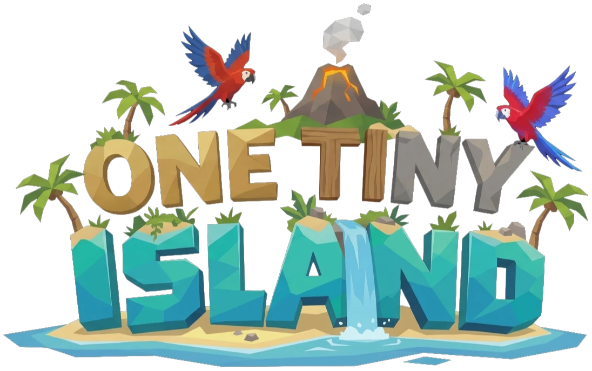
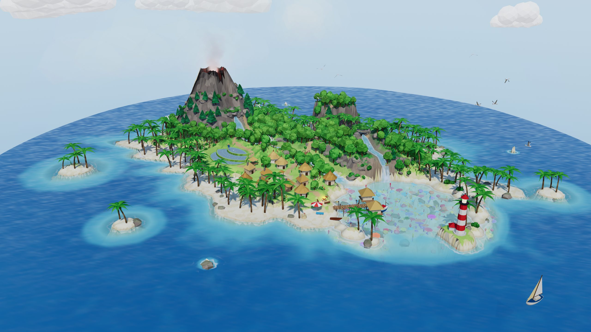
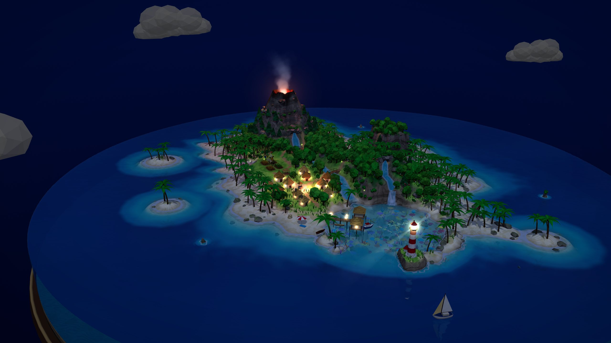
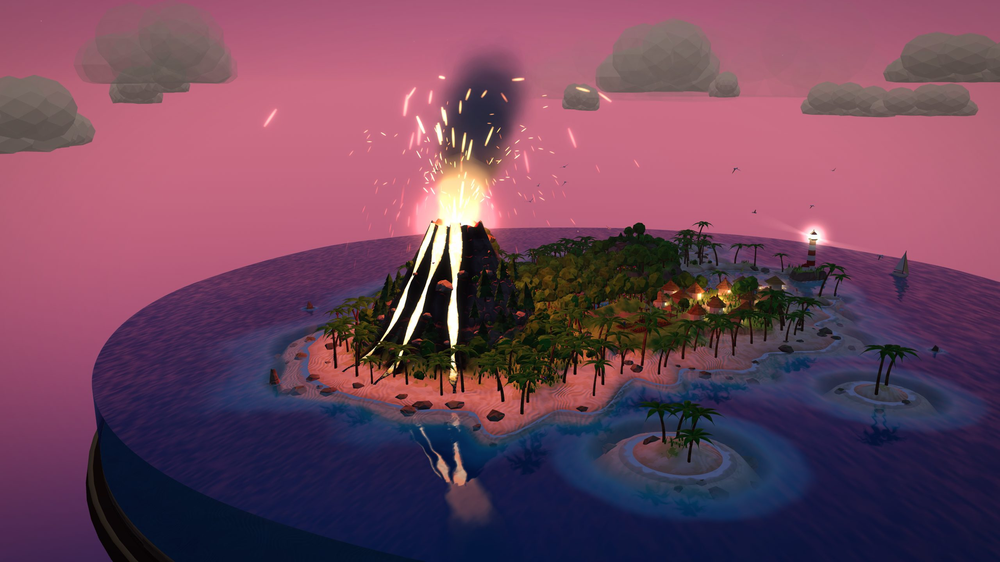
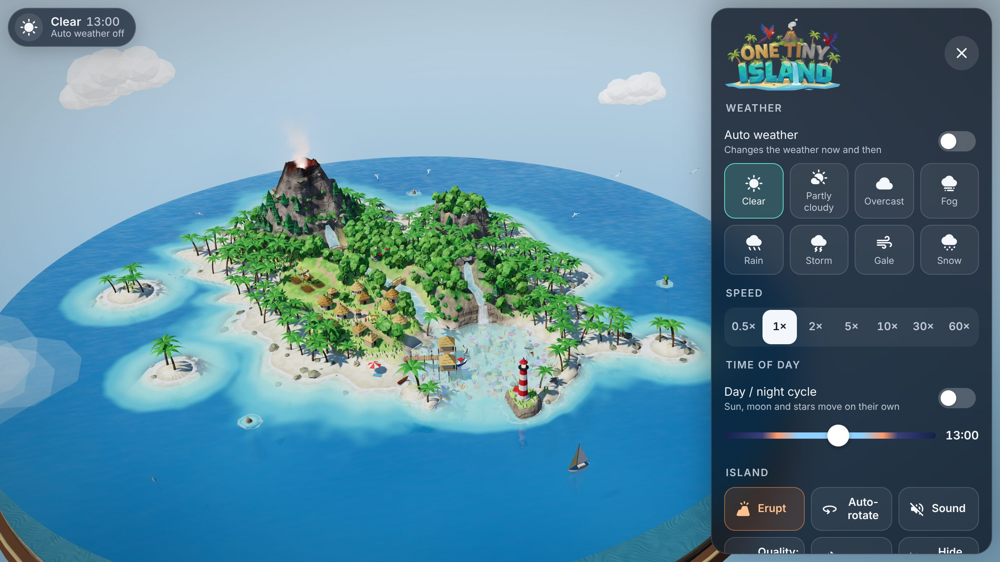
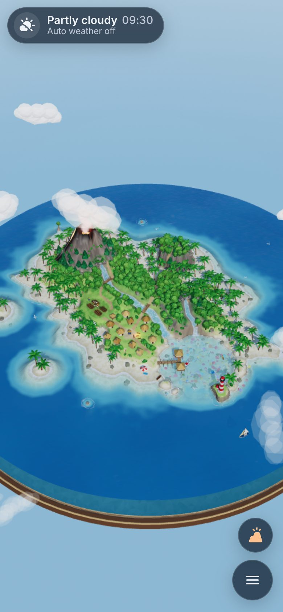

<h1 align="center"></h1>

A tiny procedural 3D island diorama that lives in a single HTML file. Open it, drag it around, and watch the weather roll in.

**[Visit the island at onetinyisland.verdet.me](https://onetinyisland.verdet.me)** — it runs right in your browser, nothing to install.



## What's in it

- **Eight weathers**: clear, partly cloudy, overcast, fog, rain, thunderstorm (with lightning), gale and snow. Left alone, the island picks its own weather every so often.
- **Day and night**: the sun, moon and stars move on their own, sunsets glow, the village lights come on after dark, and some nights bring an aurora.
- **A sleepy volcano** that smokes all day and erupts now and then, or whenever you press Erupt.
- **A little village** with huts, a jetty, a lighthouse on its own rocky islet and a waterfall.
- **A tiny farm**: a Thai-style windmill whose woven sails turn lazily on calm days and briskly in a storm, and four little wheat beds that grow from bare soil to golden ears, get harvested row by row and start again. Rain makes them grow faster; snow puts them on hold.
- **A villager with a canoe**: by day they carry it up through the village and past the farm, paddle it down the river under the footbridge and once round the lagoon, then carry it up again. At dusk, or when the weather turns, they tie it up at the jetty and go home.
- **Wildlife**: seagulls, leaping dolphins, schools of tropical fish in the lagoon, sea turtles, and three pairs of red-and-blue macaws that sit on the treetops and flit from tree to tree over the forest on fine days.
- **Snow that settles**: a real snowfall whitens the whole island and freezes the sea, and a snowy night hides a small Christmas surprise.
- **Boats** bobbing and rolling on the same waves the water shader draws.
- **A galleon and some friendly pirates**: every now and then a galleon sails by, and the pirates usually come out to meet it. They fire a few cannon puffs that always miss, the galleon fires back (also missing), and off it sails. Nobody gets hurt, nothing sinks. The ships stay in port in storms, gales and on a frozen sea.
- **Sound** (off by default): waves, wind, rain, gulls, thunder and the odd cannon "poomf".
- **Surfaces with texture**: rippled sand, patchy grass, layered rock with wet edges at the waterline, clumpy canopies, banded thatch and plank walls, all drawn by the shaders (no image files). Zoom in to see it.
- **Light and water**: lamps, the campfire and lava glow after dark, wet sand and leaves catch the sun, soft contact shadows gather under the trees, eaves and rocks, and in calm weather the island, the boats and the clouds mirror in the water. Bring the camera down low over the lagoon.
- **Quality toggle**: High or Low, for older phones and laptops. Low skips the surface detail, the rounder trees and rocks, the glow, the reflections, the contact shadows and the extra grass. If High is struggling, the page drops the reflections first, then the contact shadows, then some resolution, then the glow.

## Gallery

| | |
|---|---|
|  |  |
| Sunset | Night falls and the village lights up |
|  |  |
| Thunderstorm | Snow settles on everything |
|  |  |
| The volcano erupts | Pirates ahoy! (they always miss) |
|  |  |
| The control panel | On a phone |

## Controls

- **Drag** to orbit the island, **scroll** or **pinch** to zoom. Zoom right in, or look straight down from above.
- **Right-drag** (or **two fingers** on a phone) to slide the view around the island. The view follows the ground, so you can fly over the volcano or peek into the village.
- **Double-click** (or **double-tap**) to jump back to the starting view.
- With the island focused (click it, or Tab to it): **arrow keys** move, **Shift + arrows** turn, **+** and **-** zoom, **Home** resets.
- The **menu button** (bottom right) opens the control panel: weather, auto weather, speed, time of day and the day/night cycle, plus Auto-rotate, Sound, Quality, Erupt, Ahoy! and Hide UI, and a link to the source on GitHub at the bottom.
- **Erupt** (also the volcano button next to the menu) sets the volcano off.
- **Ahoy!** brings the galleon and the pirate ship sailing into view for a meeting (unless the weather keeps them in port).
- **H** hides or shows all the controls, handy for screenshots. **Esc** closes the panel.

## Run it

Just open `index.html` in a recent browser. There is no build step, no dependencies and nothing to install, and the page makes no network requests: everything, including three.js, is inside that one file. It needs WebGL.

If your browser is fussy about `file://` pages, any static server will do, for example `npx serve .`.

## Under the hood

- **One file.** `index.html` holds the styles, the markup and all the code. three.js (r187) and the island itself are bundled and minified into one big `<script>`. The icons are Material Symbols Rounded, inlined as SVG paths, and the text uses your system font, so nothing is downloaded.
- **A small plugin hook.** The bundle hands every function in `window.__islandPlugins` a `kit` of three.js classes and island helpers under readable names, adds the plugin's group to the scene and calls its `update` every frame. The ships are written this way, in a readable `<script id="ships">`, and every boat's hull comes from the readable builder in `<script id="boat-hull">`.
- **A console API.** Open the browser console and play:

  ```js
  __island.ships.summon()        // pirates ahoy!
  __island.erupt()               // wake the volcano
  __island.setWeather('snow')    // or 'storm', 'fog', 'gale'...
  __island.setTime(21.5)         // jump to the evening
  __island.setSpeed(30)          // fast-forward time
  __island.setAuto(false)        // stop the weather changing on its own
  __island.info()                // draw calls, triangles, current weather...
  __island.farm.state()          // the wheat, the windmill and where the villager is
  ```

  `__island.weathers` lists all the weather names.

  Curious how fast it runs on your device? Paste this into the console; it averages the frame time over 300 frames:

  ```js
  {let n=0,t0=performance.now();const f=()=>++n<300?requestAnimationFrame(f):console.log(((performance.now()-t0)/n).toFixed(1)+' ms/frame');requestAnimationFrame(f)}
  ```

  About 16.7 ms/frame means a smooth 60 frames a second. `__island.info().pixelRatio` shows whether the page has lowered its resolution by itself to keep up: it starts at your screen's pixel ratio (at most 2 on High, 1.25 on Low) and drops in steps of 0.25 when the page is struggling.

## Regenerate the screenshots

`scripts/screenshots.mjs` renders every picture in `docs/screenshots/` with headless Chromium through Playwright:

```sh
npm i -D playwright && npx playwright install chromium   # once (or use a global Playwright)
node scripts/screenshots.mjs                             # all shots, into docs/screenshots/
node scripts/screenshots.mjs --only pirates,night        # just some
node scripts/screenshots.mjs --out /tmp/shots            # somewhere else
```

It freezes the weather, the clock and the camera for each shot, steps the simulation so everything settles, and fails if the page logs an error. It takes a few minutes with software WebGL.

## Credits and licence

- [three.js](https://threejs.org/) r187 is bundled inside `index.html`. It is MIT licensed, © three.js authors.
- The icons are [Material Symbols Rounded](https://fonts.google.com/icons) by Google, inlined as SVG paths. They are licensed under the Apache License 2.0, © Google LLC.
- The GitHub mark on the panel's source link comes from [Octicons](https://github.com/primer/octicons), MIT licensed, © GitHub Inc.
- Licence texts and versions for all three: [THIRD-PARTY-NOTICES.md](THIRD-PARTY-NOTICES.md).
- How the controls look and behave, and the rules for changing them: [UI-GUIDELINES.md](UI-GUIDELINES.md).
- Everything else is © 2026 Vincent Verdet, released under the MIT licence: see [LICENSE](LICENSE).
