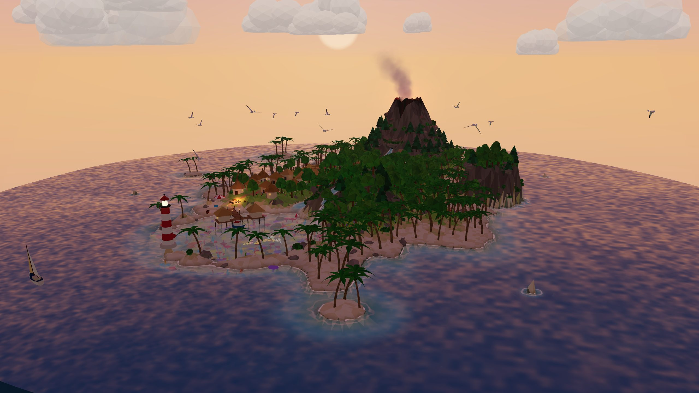
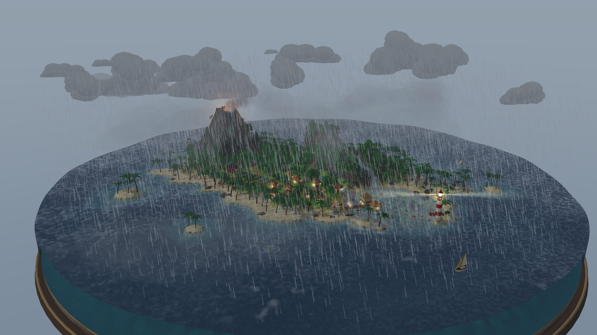
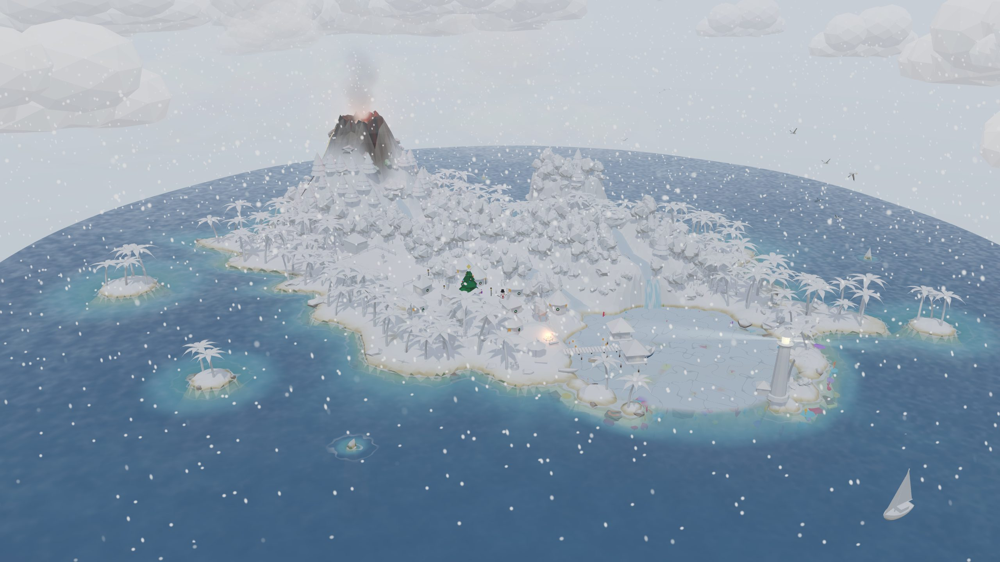
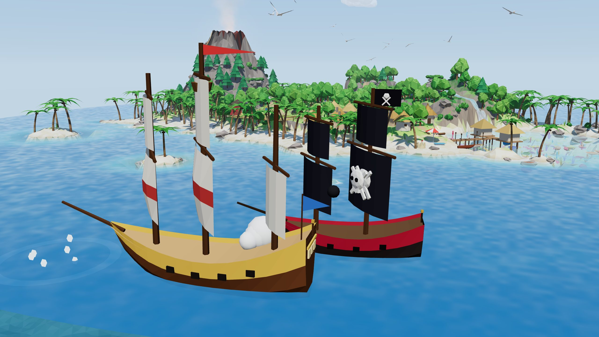

# One Tiny Island

A tiny procedural 3D island diorama that lives in a single HTML file. Open it, drag it around, and watch the weather roll in.


## What's in it

- **Eleven weathers**: clear, partly cloudy, overcast, fog, drizzle, rain, thunderstorm (with lightning), gale, hail, snow and blizzard. Left alone, the island picks its own weather every so often.
- **Day and night**: the sun, moon and stars move on their own, sunsets glow, the village lights come on after dark, and some nights bring an aurora.
- **A sleepy volcano** that smokes all day and erupts now and then, or whenever you press Erupt.
- **A little village** with huts, a farm patch, a jetty, a lighthouse and a waterfall.
- **Wildlife**: seagulls, leaping dolphins, schools of tropical fish in the lagoon and sea turtles.
- **Snow that settles**: a real snowfall whitens the whole island and freezes the sea, and a snowy night hides a small Christmas surprise.
- **Boats** bobbing and rolling on the same waves the water shader draws.
- **A galleon and some friendly pirates**: every now and then a galleon sails by, and the pirates usually come out to meet it. They fire a few cannon puffs that always miss, the galleon fires back (also missing), and off it sails. Nobody gets hurt, nothing sinks. The ships stay in port in storms, gales and on a frozen sea.
- **Sound** (off by default): waves, wind, rain, gulls, thunder and the odd cannon "poomf".
- **Quality toggle**: High or Low, for older phones and laptops. The page also lowers its resolution by itself if it is struggling.

## Gallery

| | |
|---|---|
|  |  |
| Sunset | Night falls and the village lights up |
|  |  |
| Thunderstorm | Snow settles on everything |
|  |  |
| The volcano erupts | Pirates ahoy! (they always miss) |
|  |  |
| The control panel | On a phone |

## Controls

- **Drag** to orbit the island, **scroll** or **pinch** to zoom.
- The **menu button** (bottom right) opens the control panel: weather, auto weather, speed, time of day and the day/night cycle, plus Auto-rotate, Sound, Quality, Erupt, Ahoy! and Hide UI.
- **Erupt** (also the volcano button next to the menu) sets the volcano off.
- **Ahoy!** brings the galleon and the pirate ship sailing into view for a meeting (unless the weather keeps them in port).
- **H** hides or shows all the controls, handy for screenshots. **Esc** closes the panel.

## Run it

Just open `index.html` in a recent browser. There is no build step, no dependencies and nothing to install, and the page makes no network requests: everything, including three.js, is inside that one file. It needs WebGL.

If your browser is fussy about `file://` pages, any static server will do, for example `npx serve .`.

## Publish on Cloudflare Pages

The repo is meant to be deployed with Cloudflare Pages' Git integration:

1. In the Cloudflare dashboard, create a **Pages** project, choose to connect it to Git, and pick this repository.
2. Build settings:
   - **Framework preset**: None
   - **Build command**: leave it empty (or `exit 0` if the field insists on something)
   - **Build output directory**: `/`
   - **Production branch**: `main`
3. Save and deploy.

From then on every push to `main` deploys the site, and other branches get their own preview URLs.

The `_headers` file sets caching (always revalidate the page, cache the screenshots for a day) and a few security headers. Note that the whole repo root is published, so anything you commit is reachable on the site.

After the first deploy, change the `og:image` and `twitter:image` URLs in `index.html` to absolute ones (for example `https://your-site.pages.dev/docs/screenshots/hero.jpg`) so link previews show the island.

## Under the hood

- **One file.** `index.html` holds the styles, the markup and all the code. three.js (r187) and the island itself are bundled and minified into one big `<script>`.
- **A small plugin hook.** The bundle hands every function in `window.__islandPlugins` a `kit` of three.js classes and island helpers under readable names, adds the plugin's group to the scene and calls its `update` every frame. The ships are written this way, in a readable `<script id="ships">`, and every boat's hull comes from the readable builder in `<script id="boat-hull">`.
- **A console API.** Open the browser console and play:

  ```js
  __island.ships.summon()        // pirates ahoy!
  __island.erupt()               // wake the volcano
  __island.setWeather('snow')    // or 'storm', 'fog', 'blizzard'...
  __island.setTime(21.5)         // jump to the evening
  __island.setSpeed(30)          // fast-forward time
  __island.setAuto(false)        // stop the weather changing on its own
  __island.info()                // draw calls, triangles, current weather...
  ```

  `__island.weathers` lists all the weather names.

## Regenerate the screenshots

`scripts/screenshots.mjs` renders every picture in `docs/screenshots/` with headless Chromium through Playwright:

```sh
npm i -D playwright && npx playwright install chromium   # once (or use a global Playwright)
node scripts/screenshots.mjs                             # all shots, into docs/screenshots/
node scripts/screenshots.mjs --only pirates,night        # just some
node scripts/screenshots.mjs --out /tmp/shots            # somewhere else
```

It freezes the weather, the clock and the camera for each shot, steps the simulation so everything settles, and fails if the page logs an error. It takes a few minutes with software WebGL.

## Credits and licence

- [three.js](https://threejs.org/) is bundled inside `index.html`. It is MIT licensed, © three.js authors.
- Everything else is © 2026 Vincent Verdet, released under the MIT licence: see [LICENSE](LICENSE).
